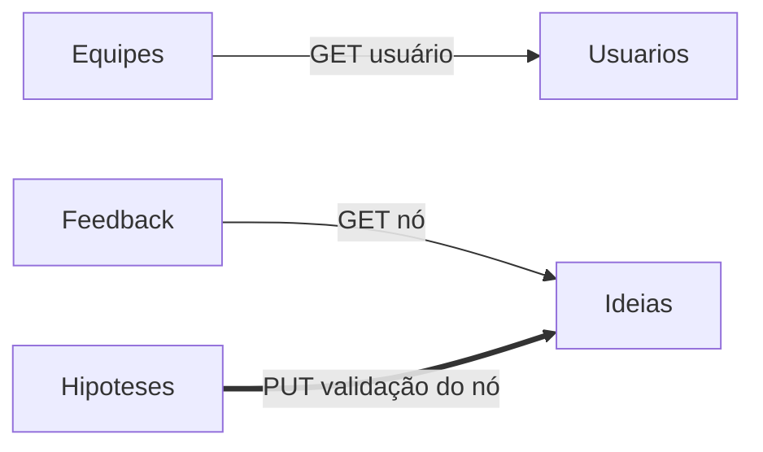
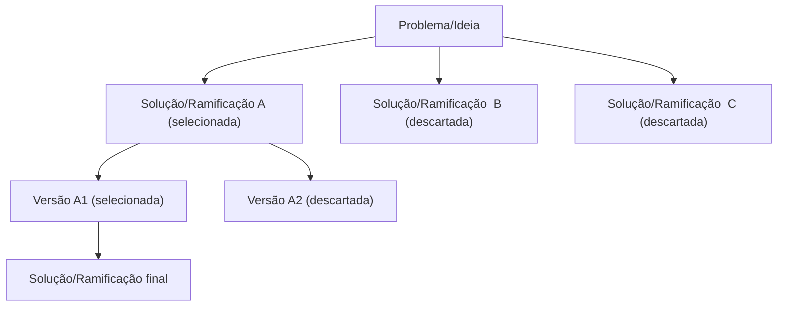

# Branchstorm

**Toda boa ideia começa aqui!**

O nome junta *branch* (ramo, como no Git) com *brainstorm* (avalanche de ideias): um brainstorm que se ramifica. Plataforma colaborativa para evoluir e validar ideias. Cada problema vira a raiz de uma árvore: pessoas propõem soluções, comentam, testam hipóteses e a equipe vai selecionando versões até chegar a uma solução final, com todo o caminho registrado.

A ideia deste projeto foi justamente pensada para ajudar em um dor dos estudantes em mapear ideias para possíveis projetos e/ou temas de inovação na área em engenharia de software. 

Este é projeto final da disciplina de Arquitetura de Software (Sistemas Distribuídos - micro serviços) em Engenharia de Software dos estudantes do Centro Universitário SATC. 

Orientado pelo professor: Eduardo Cizeski Meneghel.

- Aplicação publicada no Render: `<link do Render>`
- Equipe: `Pedro Pavei`, `Matheus`, `Thales Vaz`

---
## 1. Requisitos

### 1.1 Propósito do sistema

Permitir que pessoas e equipes cadastrem problemas e/ou ideias, desenvolvam soluções em forma de árvore (com versões e ramos alternativos para discussão ou reflexão), recebam feedback, discutam e/ou testem hipóteses, mantendo o histórico de por que cada caminho foi escolhido ou descartado. A inspiração é o Git: cada mudança é registrada. Ideal para protótipos e para anotações de ideias para futuros projetos e/ou trabalhos. 

### 1.2 Usuários

| Usuário | O que faz |
|---|---|
| Autor | Cria o problema/ideia raiz e propõe soluções e versões |
| Colaborador | Membro de uma equipe que propõe soluções, cria hipóteses e comenta |
| Avaliador | Comenta e dá nota nas ideias; pode ser convidado para uma equipe |

### 1.3 Requisitos funcionais

| Código | Requisito |
|---|---|
| RF01 | Cadastrar, consultar e listar usuários |
| RF02 | Criar equipes e adicionar/remover membros com um papel (dono, colaborador, avaliador) |
| RF03 | Cadastrar um problema/ideia raiz |
| RF04 | Propor soluções e novas versões como filhos de um nó da árvore, informando o motivo |
| RF05 | Selecionar um nó (os irmãos viram descartados) e marcar um nó como solução final |
| RF06 | Consultar a árvore completa de uma ideia, incluindo nós descartados |
| RF07 | Cadastrar hipóteses em um nó, com critério de sucesso |
| RF08 | Registrar o resultado de uma hipótese (validada ou refutada) |
| RF09 | Atualizar automaticamente a validação do nó a partir do resultado da hipótese |
| RF10 | Comentar e dar nota em um nó, apenas se ele estiver aberto a feedback |
| RF11 | Listar os feedbacks de um nó |

### 1.4 Regras de negócio principais

- Nós descartados nunca são apagados, só mudam de status.
- Apenas um filho por nível pode estar selecionado.
- Feedback só é aceito em nós com status `aberto`.

---

## 2. Descritivo técnico

### 2.1 Visão geral

- Back-end com arquitetura de microsserviços, cada microserviço segue o template visto em sala: **.NET, SQLite e REST**. 
- Frontend em Angular.

Cada serviço tem seu próprio banco e só conversa com os outros por HTTP no padrão REST.



Linhas finas são buscas de dados; a linha grossa é a alteração de dados entre serviços.

### 2.2 Microsserviços

| Serviço | Função |
|---|---|
| **Usuários** | Cadastro e consulta dos usuários |
| **Equipes** | Equipes, membros e papéis |
| **Ideias** | Árvore de nós (problema, soluções, versões), status e histórico |
| **Hipóteses** | Hipóteses por nó, critério de sucesso, experimento e resultado |
| **Feedback** | Comentários e notas por nó |

#### Usuários
- Endpoints: 
	- `POST /api/users`
	- `GET /api/users`
	- `GET /api/user/{Code}`
- Dados: `Usuario(Code, Nome, Email)`
- Integrações: é consultado pelo serviço de Equipes.

#### Equipes
- Endpoints: 
	- `POST /api/team`
	- `GET /api/team/{Code}` (com dados dos membros), 
	- `POST /api/team/members/{Code}`
- Dados: 
	- `Team (Code, Name)`
	- `TeamMember (TeamCode, UserCode, Role)`
- Integrações: busca dados de cada membro no serviço de Usuários.

#### Ideias
- Endpoints: 
	- `POST /api/link`
	- `GET /api/link/{code}`, 
	- `GET /api/link/tree/{code}`
	- `PUT /api/link/select/{code}`
	- `PUT /api/link/validation/{code}`
- Dados: 
	- `Link (Code, FatherCode, Type, Title, Description, Status, Validation, AutorCode, TeamCode, Reason, CreationDate)` 
	- `LinkHistory (Code, LinkCode, Event, CreationDate)`
	
	- `Type`: 
		- `problem`, `solution`, `version`. 
	- `Status`: 
		- `open`, `selected` ,`discarded`, `final`. 
	- `Validation`: 
		- `not_tested`, `validate`, `refuted`.
		
- A árvore é consultada com CTE recursiva do SQLite.
- Integrações: é consultado pelo Feedback e recebe a atualização de validação vinda de Hipóteses.



#### Hipóteses
- Endpoints: 
	- `POST /api/hypothese`
	- `GET /api/hypothese?linkCode={code}`
	- `PUT /api/hypotese/result/{code}`
- Dados: 
	- `Hypotese(Code, LinkCode, Description, Sucess, Result, CreationDate)`
- Integrações: ao registrar o resultado, chama o serviço de Ideias para atualizar a validação do nó( *Link*).

#### Feedback
- Endpoints: 
	- `POST /api/feedbacks`
	- `GET /api/feedbacks?linkCode={code}`
- Dados: 
	- `Feedback(Code, LinkCode, AutorCode, Test, Note, CreationDate)`
- Integrações: antes de salvar, consulta o serviço de Ideias para validar que o nó(*Link*) existe e está aberto.

### 2.3 Integrações entre microsserviços

| #   | Tipo               | Origem → Destino   | O que acontece                                                                                                                |
| --- | ------------------ | ------------------ | ----------------------------------------------------------------------------------------------------------------------------- |
| 1   | Busca de dados     | Equipes → Usuários | Ao exibir uma equipe, busca os dados de cada membro (`GET /api/user/{code}`)                                                  |
| 2   | Busca de dados     | Feedback → Ideias  | Ao cadastrar um feedback, valida se o nó existe e está aberto (`GET /api/link/{code}`)                                        |
| 3   | Alteração de dados | Hipóteses → Ideias | Ao registrar o resultado de uma hipótese, atualiza a validação do nó e grava no histórico (`PUT /api/link/validation/{code}`) |

---

## 3. Trabalhos relacionados e diferencial

Já existem ferramentas e projetos que cobrem partes do Branchstorm:

- **Gestão de ideias corporativa** (por exemplo [HYPE](https://www.hypeinnovation.com/product/hype-go) e Ideanote): captura de ideias, votação, comentários e avaliação por critérios, sem versionamento de ideias.
- **Git para ideias**: projetos como [OpenIdeate](https://github.com/thanethomson/openideate) (pool de ideias com votos e forks) e [ideaBin](https://github.com/deepthought42/ideaBin) (um repositório Git por ideia), além do projeto de tese [Versionize](https://gist.github.com/runemadsen/941519), que usa Git para iterar ideias.
- **Árvores de discussão**: o [Kialo](https://en.wikipedia.org/wiki/Kialo) organiza debates em árvore, com a tese na raiz e argumentos a favor e contra nos ramos, mas é voltado a debate, não à evolução de soluções.

**Diferencial do Branchstorm:** combinar numa só plataforma a árvore problema → soluções → versões, com seleção e descarte registrados, e hipóteses com resultado que atualizam o estado dos nós. Pelo que pesquisamos, essa combinação não aparece nas ferramentas acima.

---

## 4. Tecnologias

- .NET (template de microsserviço da disciplina)
- Angular (frontend)
- SQLite (um banco por serviço)
- Padrão REST sobre HTTP
- Servidor container Render

## 5. Como executar

```bash
A ver ainda
```

## 6. Extras e evolução futura

### 6.1 Extras previstos

- Integração com IA: 
	- sugestão de problemas/ideias aleatórios para discussão em grupo 
	- resumir os feedbacks de um nó (*link*) e sugerir hipóteses a partir da descrição.
- Comunicação assíncrona na integração Hipóteses → Ideias (mensageria).
- Observabilidade: logs estruturados e health checks em todos os serviços (provavelmente Swarmpit)

### 6.2 Ideias de evolução

- **Troca de perspectivas (brainstorm aleatório):** a plataforma sorteia pares de equipes. A equipe A lança um problema e a equipe B propõe as soluções; depois os papéis se invertem. Seria um novo serviço, **Desafios**, que cria o nó (Link) raiz na equipe A e designa a equipe B para responder, reaproveitando os serviços de Ideias e Equipes.
- **Batalha de equipes:** várias equipes recebem o mesmo problema e cada uma desenvolve a própria árvore de soluções. No fim, os caminhos são comparados (hipóteses validadas, feedback recebido, profundidade da árvore).
- **Fork de ideias** entre equipes e votação nos nós.
- **Ranking de equipes** e modo relâmpago, com tempo limitado para propor soluções.
- **Login simplificado** para agil uso com grandes grupos
- **Salas de discussão simplificadas** (estilo Kahoot)
